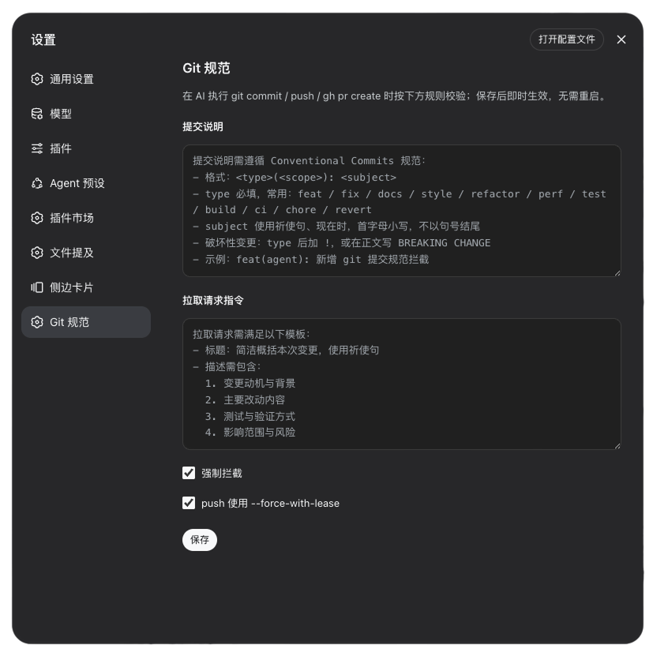
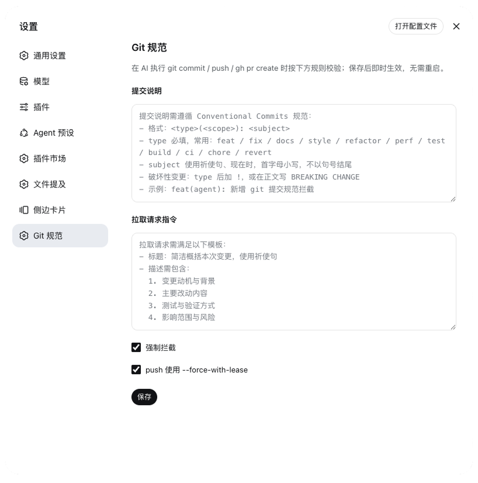

# dsh-git-conventions

适配 DSH `0.2.1-rc.2`（`@deepseek-ai/dsh` ≥ 0.2.1-rc.2 < 0.3.0）。

从 `0.1.x` 升级：配置已从旧版**独立的 settings namespace**迁移到**插件条目自身的 `Config` schema**。旧配置不会再被读取，请在「设置 → 插件 → Git 规范」重新填写并保存一次。`0.1.x` 的 DOM 导航图标补丁已移除，设置页现在作为「插件」页里的一个页签出现。

**简体中文** | [English](./README.en.md)

[](https://www.npmjs.com/package/dsh-git-conventions)
[](https://github.com/CN-WenYu/dsh-git-conventions/blob/main/LICENSE)

为 DeepSeek Harness 提供可配置的 Git 提交 / 推送 / 拉取请求规范（静态插件，Host + Client 双端）。采用固定的结构检查，并在拒绝时回显可配置的重写指引。设置是插件条目自身的 `Config`，由宿主持久化到当前 profile 的 `cordis.patch.yml`；自定义文字不会自动转为可执行校验规则，也不会主动注入模型上下文。

## 功能特性

- **提交规范校验**：对 `git commit -m` 的内联消息做 Conventional Commits 结构检查，不合规即拒绝，并回显不合规点与当前规则
- **推送安全**：`git push` 使用 `--force` / `-f`（含组合短选项）或 `+refspec` 时，提示改用 `--force-with-lease`
- **PR 完整性**：`gh pr create` 缺少非空标题或正文来源（`--body` / `--body-file`）时拒绝，并给出补齐提示
- **可配置重写指引**：固定检查 Conventional Commits 结构、空消息、句号结尾与 PR 必要参数；自定义语言、scope 或章节要求仅作为拒绝后的指引
- **逐项开关**：三类结构检查各自独立开关，另有总开关「强制拦截」可一键放行
- **可配置监听范围**：默认拦截 `bash` 与 `terminal_send`，可自行增删监听工具
- **实时生效**：设置页保存后立即生效，无需重启
- **多语言**：设置页与拦截消息支持简体中文 / 英文，跟随宿主语言偏好

## 截图

以下截图为 `0.1.x` 的独立设置页，仅用于展示配置项形态；`0.2.x` 起同一组配置位于「设置 → 插件 → Git 规范」页签：





## 安装

本包已发布到 [npm](https://www.npmjs.com/package/dsh-git-conventions)，在目标 profile 按包名安装即可。`dsh plugin add` 会读取 `package.json` 中 `dsh.bundle.patch` 指向的 `cordis.patch.yml`，并把包名追加进 `dsh.profile.bundles`：

```sh
dsh plugin --profile web add dsh-git-conventions
dsh web
```

重启后「设置 → 插件」中出现「Git 规范」页签。更新 / 卸载：

```sh
dsh plugin --profile web update dsh-git-conventions   # 更新
dsh plugin --profile web remove dsh-git-conventions  # 卸载
```

### 本地开发

以工作区路径安装会建立 `link:` 依赖（改源码后重启即生效）。此时宿主解析 `import z from '@deepseek-ai/schemastery'` 走模块真实路径，需在工作区补一个可解析的依赖：

```sh
dsh plugin --profile web add <本包路径>
npm ci
```

按 npm 包名安装则无需手动安装工作区依赖（包被复制进 profile 的 `node_modules`，依赖沿 profile 正常解析）。

## 配置项

配置属于插件条目 `git-conventions` 自身的 `Config`（整张 schema 标记为 `volatile`，因此全部字段都可实时编辑）。等价于在 profile 的 `cordis.patch.yml` 中写入：

```yaml
- id: git-conventions
  config:
    enforce: true
    tools: [bash, terminal_send]
```

| 字段 | 类型 | 默认 | 含义 |
|---|---|---|---|
| `enforce` | boolean | `true` | 总开关；关闭后守卫不再介入，全部放行 |
| `tools` | string[] | `["bash", "terminal_send"]` | 监听的工具名；只检查这些工具参数中的命令行 |
| `strictCommit` | boolean | `true` | 对 `git commit -m` 内联消息做 Conventional Commits 结构检查 |
| `useForceWithLease` | boolean | `true` | `git push` 出现强制选项或 `+refspec` 时提醒改用 `--force-with-lease` |
| `requirePrBody` | boolean | `true` | `gh pr create` 必须提供非空标题与正文来源 |
| `commitInstructions` | string | 空 → Conventional Commits（zh/en 随语言） | 重写指引；固定结构检查拒绝时回显 |
| `prInstructions` | string | 空 → PR 模板（zh/en 随语言） | PR 重写指引；不自动检查描述章节 |

保存通过宿主 `settings.mutate` 以一次带 revision 校验的原子操作提交全部改动，成功后即时生效（守卫每次调用都读取实时配置）。未编辑时跟随宿主更新；编辑过程中配置若被其他页面修改，保存会被版本检查拒绝并提示重新加载。

## 国际化

界面文案、默认规则文本与拦截消息均支持 `zh` / `en`，跟随宿主语言偏好（dsh 设置 → 通用 → 语言，持久化为当前 profile 中 `locale` 条目的 `preference`）。未显式选择时，客户端回退浏览器语言，服务端回退中文。自定义规则文本与语言无关，一旦保存始终优先于默认规则。

## 使用示例

### 合规：正常放行

```sh
git commit -m "feat(agent): 新增 git 提交规范拦截"
git commit -m "fix(commit): 修正 subject 校验的空消息边界"
git push --force-with-lease
gh pr create --title "feat: 支持 scope 校验" \
  --body "动机与背景 / 主要改动 / 测试与验证 / 影响范围"
```

### 违规：被拦截

```sh
# 缺少 <type>(<scope>): <subject> 前缀 → 拒绝
git commit -m "新增提交规范拦截"

# subject 以句号结尾 → 拒绝
git commit -m "feat: 新增提交规范拦截。"

# 裸 --force（useForceWithLease=true 时）→ 提醒改用 --force-with-lease
git push --force
git push -f

# 缺少 PR 标题或描述 → 拒绝
gh pr create --title "feat: 新增校验"          # 缺 --body
gh pr create --body "缺少标题"                  # 缺 --title
```

拦截时 reason 列出具体不合规点、当前配置的完整规则文本，并提示「请重写后重新提交」。以 `git commit` 为例，agent 收到的拒绝消息形如：

```
提交信息不符合配置的提交说明规则：
  - 提交首行需符合 "<type>(<scope>): <subject>" 格式，例如 "feat(agent): 说明"

当前提交说明规则：
提交说明需遵循 Conventional Commits 规范：
- 格式：<type>(<scope>): <subject>
- type 必填，常用：feat / fix / docs / style / refactor / perf / test / build / ci / chore / revert
- subject 使用祈使句、现在时，首字母小写，不以句号结尾
- 破坏性变更：type 后加 !，或在正文写 BREAKING CHANGE
- 示例：feat(agent): 新增 git 提交规范拦截

请重写后重新提交。
```

### 范围与默认值

- `git commit -F commit-msg.txt`：不读取文件内容，仅检查内联消息
- 关闭「强制拦截」（`enforce=false`）后的所有命令
- 规则文本留空（或清空）时回退到当前语言默认规则，校验仍生效

## 工作原理

Host 端通过 `ctx.tools.guard()` 注册全局守卫（追加在 `tools/pre-execute` 之后，只能拒绝、不能强制放行），拦截 `tools` 中列出的工具：

- `git commit` 带 `-m` / `--message` 时提取消息并做 Conventional Commits 结构校验；不合规则 deny，reason 含不合规点、完整规则与「请重写后重新提交」。
- `git push` 含 `--force` / `-f`（含组合选项）或 `+refspec` 且 `useForceWithLease=true` 时，提醒改用 `--force-with-lease`。
- `gh pr create`（含 `gh pr new`）要求非空标题与正文或正文来源；`--body-file` / `-F` 仅检查来源参数存在，不验证文件或标准输入内容。`--fill` / 编辑器流程不会自动视为满足要求。

## 已知限制

- 本插件只检查 `tools` 中列出的工具的常见显式命令（默认 `bash` 与 `terminal_send`），不改写参数，也不覆盖 PowerShell、外部脚本、别名或其他执行工具；不是不可绕过的安全边界。
- `terminal_send` 的 `text` 会被逐行检查；只输入部分命令（未提交）时也按单行命令解析。
- 支持普通引号、空参数、命令分隔与常见重定向。变量展开、命令替换、here-document 和复杂 shell 语法不做运行时求值；包含未求值变量／通配符的命令会跳过；包含命令替换、括号、here-document 或不匹配引号的整个调用不检查。这是尽力而为的守卫，不是完整 Bash 解析器。
- 不读取 `-F` / `--file` 指向的文件，文件消息不校验（仅处理 `-m` / `--message` 内联消息）。
- 自定义文字不会改变固定检查：中文、scope 必填、祈使句、PR 章节等自然语言要求不被自动验证。

## 许可证

MIT License © 2026 雨果，详见 [LICENSE](LICENSE)。
